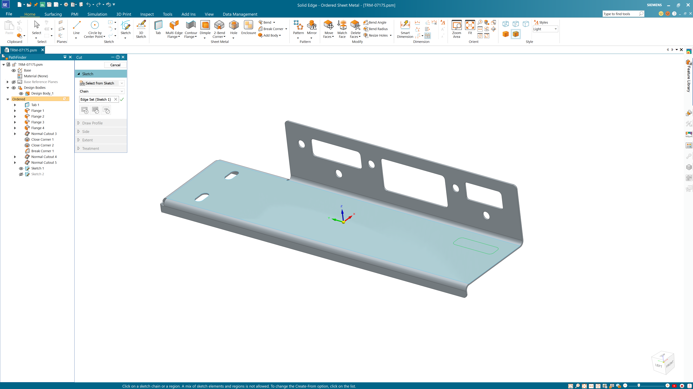
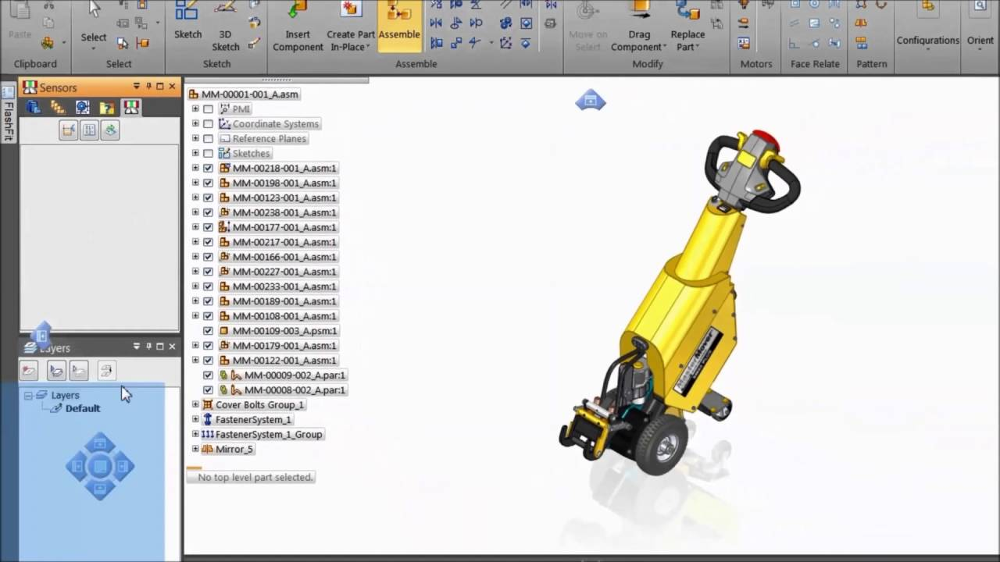

# Solid Edge for Mechanical Modeling and Design Changes

A changed hole spacing, a supplier's imported part, and an updated assembly each require a different kind of CAD decision.
Solid Edge software provides mechanical modeling and drawing tools for carrying those changes through a design.

This guide focuses on model intent, parameter relationships, and small automation tasks in Siemens Solid Edge.
The reference files in this repository come from SolveSpace: they expose a separate geometric solver, language bindings, and integration material.
They are included for comparison and study, not as Solid Edge source code or compatible project files.

## Samples

A useful automation task starts with a precise document context.
A part, sheet-metal part, assembly, and drawing expose different objects and operations.
Establish the document type before attempting to change geometry.

The following original VBScript connects to an already running Solid Edge instance and creates an unsaved part.
It requires an installed, licensed application and an available Windows Script Host/VBScript environment.

```vbscript
Option Explicit
Dim app, part
Set app = GetObject(, "SolidEdge.Application")
Set part = app.Documents.Add("SolidEdge.PartDocument")
app.Visible = True
WScript.Echo "Created document: " & part.Name
Set part = Nothing
Set app = Nothing
```

The document uses the associated default part template.
No solid geometry is created by this example, and no file is saved.
Use a template appropriate to the engineering units and drawing conventions of the actual project.

[](https://solid-edge-software.github.io/siemens-solid-edge/)

For a geometric-solver comparison, [CDemo.c](exposed/CDemo.c) constructs entities and constraints through the SolveSpace library.
Its companion [DOC.txt](exposed/DOC.txt) explains parameters, entities, and constraints as separate concepts.
The callable interface is declared in [slvs.h](include/slvs.h).

Those concepts help explain why a sketch can contain many entities yet remain underconstrained.
Position, orientation, size, and relationships all contribute to the remaining freedom of a design.
Start by deciding which movement is intentional rather than fixing every point indiscriminately.

### Key features

Solid Edge combines ordered modeling with synchronous technology for dimension-driven geometric changes.
Synchronous editing is useful when working with imported geometry or changes that do not follow an original feature sequence.
Ordered modeling preserves an explicit sequence of modeling operations.

Choose the modeling approach according to the relationship that must survive the edit.
A face move, a changed pattern count, and a redesigned base sketch do not express the same design intent.



## Overview

For **siemens solid edge cad**, the important question is how the model should behave after a change.
A successful edit should preserve the relationships needed by the part, assembly, and associated documentation.

| Design situation | Ordered approach | Synchronous approach | Check after the change |
| --- | --- | --- | --- |
| A feature depends on a particular sketch | Edit the relevant sketch or feature parameters | Apply suitable dimensional and face relationships | Whether dependent geometry still expresses the intended feature |
| A supplied model lacks a useful history | Use appropriate direct-edit features within the ordered workflow | Edit faces and dimensions without reconstructing the original history | Interfaces and neighboring geometry |
| A standard component needs another size | Update the controlling dimensions and formulas | Change dimensions while retaining selected relationships | Fits, clearances, and overall dimensions |
| An assembly interface moves | Review the affected parts and assembly relationships | Use available assembly-context editing tools | Mating conditions and updated drawings |

A parameter name should communicate an engineering role.
Names such as HoleCount or RibCount are easier to interpret than an unexplained numeric setting.
Keep units explicit for dimensional quantities and distinguish a count from a length.

The next independent VBScript assumes that an editable part document is already active.
It adds two dimensionless variables, with the second derived from the first.

```vbscript
Option Explicit
Dim app, doc, countVar, gapVar
Set app = GetObject(, "SolidEdge.Application")
Set doc = app.ActiveDocument
Set countVar = doc.Variables.Add("DemoHoleCount", "5")
Set gapVar = doc.Variables.Add("DemoGapCount", "DemoHoleCount - 1")
WScript.Echo "Gap-count formula: " & gapVar.Formula
Set doc = Nothing
Set app = Nothing
```

Run it once on a suitable working document; the chosen variable names must not already exist.
Adding variables alone does not create holes or bind the values to existing features.
Connecting them to a model requires the relevant dimensions or feature parameters.

The API examples use documented COM calls; confirm behavior against the SDK for the installed release.
The archived Solid Edge community examples can provide further context for legacy automation code.

In the supplied comparison material, [VbDemo.vb](exposed/VbDemo.vb) demonstrates calling the SolveSpace library from .NET.
Its [CMakeLists.txt](exposed/CMakeLists.txt) defines the C demonstration's build target.
This is a native-library integration pattern, distinct from the COM calls shown above.

An assembly review extends beyond the currently edited part.
Check mounting locations, interference-sensitive regions, and the effect on adjacent components.
When producing drawings, confirm that the views and dimensions reflect the intended model revision.

Users searching for **siemens solid edge software** may also need sheet-metal, simulation, or manufacturing functions.
These belong to the wider portfolio; their availability depends on the selected product and license.
Check the actual entitlement before planning a workflow around an additional module.

## Community

A CAD integration can expose the same geometric concepts through several programming languages.
The supplied files make that boundary visible without requiring a full modeling application to be treated as an SDK.

For Python, [__init__.py](python/slvs/__init__.py) exports the solver functions.
The typed declarations in [solvespace.pyi](python/slvs/solvespace.pyi) describe entities and supported constraints.
The mechanism example in [test.py](python/tests/test.py) shows how a set of geometric relationships can become an executable check.

A useful mechanism check varies the intended input and observes the remaining motion.
Record the assumptions about fixed points and permitted movement before interpreting a solver result.
A solved geometric configuration is not by itself a stress or manufacturing analysis.

The JavaScript-facing declarations appear in [slvs.d.ts](js/slvs.d.ts).
Package metadata lives in [package.json](package.json), while the Python build is described in [pyproject.toml](pyproject.toml).
For performance-study infrastructure, [harness.cpp](bench/harness.cpp) separates setup, benchmark work, and teardown.

These references can support a discussion about repeatable CAD calculations.
They do not establish numerical equivalence with Solid Edge's constraint or modeling engines.



Navigation hardware is another integration boundary in a mechanical-design workstation.
Evaluate rotation, translation, selection, and command access as separate interaction tasks.
A device's availability in one CAD program does not establish support in another.

The collected SpaceWare integration headers describe that lower-level boundary:

- [si.h](extlib/si/si.h) declares the input-library interface.
- [siapp.h](extlib/si/siapp.h) declares application-facing functions and types.
- [spwerror.h](extlib/si/spwerror.h) defines library error values.
- [siSync.h](extlib/si/siSync.h) describes GUI synchronization messages.

For **solid edge community edition**, verify the current use restrictions and capabilities with Siemens.
Community contributions, a community software edition, and an official product SDK are different resources.
An archived automation sample should be assessed against the installed application rather than assumed current.

Distribution files provide context about the separate reference application.
The Snap definition is in [snapcraft.yaml](pkg/snap/snap/snapcraft.yaml), with its packaging helper in [build.sh](pkg/snap/build.sh).
The Flatpak definition is [com.solvespace.SolveSpace.json](pkg/flatpak/com.solvespace.SolveSpace.json), accompanied by another [build.sh](pkg/flatpak/build.sh).
These files concern Linux packaging of SolveSpace and are not installation instructions for Solid Edge.

## License

Solid Edge is proprietary software supplied under Siemens' applicable license terms.
The collected SolveSpace and third-party integration files retain their own copyright and license notices.
Review the notices for each component when reusing or distributing reference material.

## Reporting Issues

A useful CAD issue report starts with the failed design operation and the expected geometric result.
Describe whether the model uses ordered features, synchronous edits, imported geometry, or a combination.
Include the release, document type, and smallest reproducible part or assembly that can be shared.

For automation problems, distinguish failure to connect to the application from failure of a document-specific method.
Identify the active document type and the exact call involved.
The two examples above are documentation examples and have not been executed against the local application.

Siemens' [3D design overview](https://solidedge.siemens.com/en/solutions/products/3d-design/) describes the modeling portfolio.
The [synchronous technology overview](https://solidedge.siemens.com/en/solutions/products/3d-design/synchronous-technology/) discusses imported-model editing.
The historical SDK pages document [document creation](https://support.industrysoftware.automation.siemens.com/trainings/se/107/api/SolidEdgeFramework~Documents~Add.html) and [variable creation](https://support.industrysoftware.automation.siemens.com/trainings/se/106/api/SolidEdgeFramework~Variables~Add.html).
Use the SDK matching the installed release for production integration.

## Related Search Terms

solid edge software, siemens solid edge, siemens solid edge cad, siemens solid edge software, solid edge community edition, cad, parametric, modeling, mechanical-engineering, geometry, constraints, 3d, step, automation, windows
